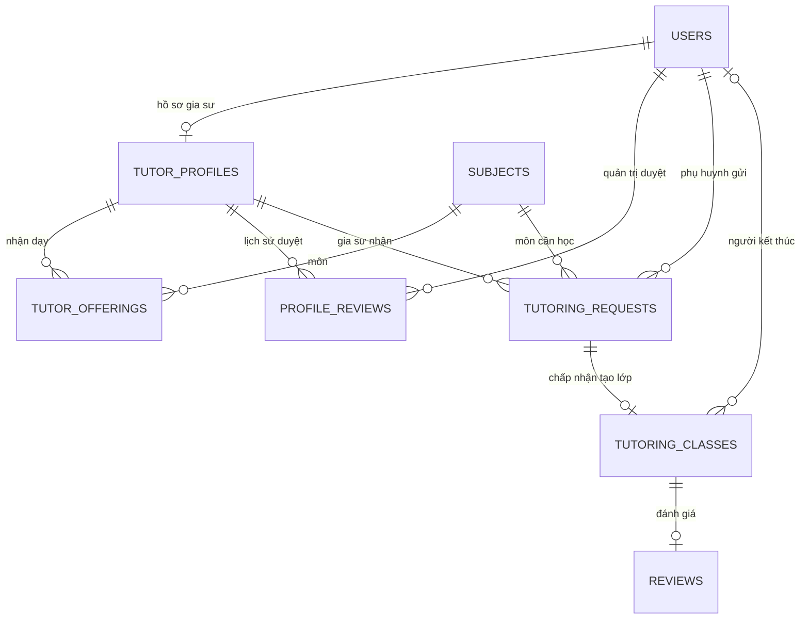

# Thiết kế cơ sở dữ liệu PostgreSQL

Hệ quản trị: PostgreSQL 16. Migration hiện hành nằm ở `backend/src/main/resources/db/migration/`. Bản MySQL cũ chỉ được giữ trong `db/legacy/mysql/` để tra cứu lịch sử; Flyway không quét thư mục đó. Chuyển đổi hiện tại tạo database PostgreSQL mới, chưa phải công cụ chuyển dữ liệu MySQL đang vận hành.

## ERD khái quát



[Nguồn sơ đồ đầy đủ các trường](../tai-nguyen/so-do/quan-he-du-lieu.mmd). SQL migration là nguồn chính xác cho kiểu cột, CHECK và index; sơ đồ giúp giải thích quan hệ.

## Từ điển bảng

| Bảng | Khóa / quan hệ | Dữ liệu chính và lý do |
|---|---|---|
| users | id identity PK; unique lower(email) | Tên, email, password_hash, vai trò, trạng thái; không phân biệt email hoa/thường |
| tutor_profiles | user_id vừa PK vừa FK users | Giới thiệu, học vấn, kinh nghiệm, hình thức/khu vực, lịch tham khảo, trạng thái duyệt, version |
| subjects | id PK; name unique | Danh mục môn học có active; V2 thêm 7 môn, không thêm người dùng giả |
| tutor_offerings | FK tutor/subject; unique tutor+subject+grade | Một tổ hợp gia sư/môn/khối lớp/học phí; tránh suy diễn sai môn và khối |
| profile_reviews | FK gia sư và người duyệt | Quyết định, lý do, JSONB chụp hồ sơ và môn dạy tại lúc duyệt |
| tutoring_requests | FK phụ huynh/gia sư/môn | Bản chụp nhu cầu và học phí; trạng thái, lý do, version |
| tutoring_classes | FK request_id unique | Trạng thái lớp, người kết thúc, lý do hủy, version |
| reviews | FK class_id unique | Điểm nguyên 1–5, nhận xét, ngày tạo |

PK dùng BIGINT GENERATED BY DEFAULT AS IDENTITY. Tiền là số nguyên đồng/giờ, không dùng float. Mốc sự kiện dùng TIMESTAMPTZ; ngày bắt đầu dự kiến dùng DATE. Múi giờ hiển thị Asia/Ho_Chi_Minh; dữ liệu thời điểm không phụ thuộc múi giờ máy người xem. Trigger tự cập nhật updated_at của users và tutor_profiles.

## Các ràng buộc quan trọng

| Quy tắc | Database | Service Java |
|---|---|---|
| Email không trùng hoa/thường | Unique index lower(email) | Strip, lowercase; ánh xạ xung đột thành 409 |
| Chỉ đăng ký PARENT/TUTOR | CHECK bảng cho phép cả ADMIN để quản trị hệ thống | API đăng ký chặn ADMIN; không suy ra quyền từ payload |
| Gia sư đăng ký có hồ sơ DRAFT | FK và PK user_id | Giao dịch tạo user + profile, rollback cùng nhau |
| Không trùng yêu cầu chờ | Partial unique index khi status=PENDING | Chuẩn hóa tên, kiểm tra quyền và giải thích lỗi |
| Một yêu cầu chỉ tạo một lớp | Unique request_id | Chấp nhận + tạo lớp trong một giao dịch |
| Một lớp chỉ có một đánh giá | Unique class_id, CHECK rating 1–5 | Chỉ phụ huynh đúng lớp COMPLETED được gửi |
| Thông tin thỏa thuận không đổi | Không tự xóa FK | Không cho sửa nội dung yêu cầu sau khi gửi |
| Chống đổi trạng thái cùng lúc | Cột version, ràng buộc cấu trúc | Khóa hàng hoặc cập nhật có điều kiện, xử lý 409 |

Không viết rằng CHECK đã kiểm tra được chủ sở hữu, vai trò của FK, trạng thái lớp ở bảng khác hoặc quyền truy cập; đó là trách nhiệm service và kiểm thử nghiệp vụ. Ngoài đăng ký, các service này chưa được triển khai.

Index chống trùng yêu cầu chờ:

```sql
CREATE UNIQUE INDEX uq_pending_request
ON tutoring_requests(parent_id, tutor_id, student_name_normalized, subject_id)
WHERE status = 'PENDING';
```

Tên học sinh không phải định danh tuyệt đối: hai con cùng tên trong cùng gia đình có thể bị coi là trùng. Bản đầu giữ quy tắc đã thống nhất; khi thêm hồ sơ học sinh sẽ thay bằng student_id. Java cần chuẩn hóa Unicode, gom khoảng trắng, giữ dấu và chuyển chữ thường nhất quán trước khi tạo yêu cầu.

## Yêu cầu, lớp và học phí

Yêu cầu giữ nội dung gốc: môn, khối, tên gọi học sinh, mục tiêu, lịch mong muốn, hình thức, khu vực, giá đề xuất và ngày bắt đầu. Lớp tham chiếu yêu cầu để đọc thỏa thuận, không lấy học phí niêm yết hiện tại của gia sư. Tăng giá niêm yết không làm tăng giá lớp cũ.

## Quản lý migration

- V1 tạo bảng, khóa, index và trigger; V2 thêm môn học.
- Không dùng Flyway clean trên database sử dụng thật, không tự xóa data để sửa lỗi.
- Sau khi migration đã áp dụng, bổ sung V3/V4 khi có thay đổi; không chỉnh lại checksum để giấu thay đổi.
- Kiểm thử PostgreSQL tạo schema tên ngẫu nhiên, áp dụng chính migration sản phẩm rồi chỉ dọn schema do bài kiểm thử tạo.
- Không commit dữ liệu PostgreSQL, mật khẩu hoặc dump chứa dữ liệu cá nhân.

Tham khảo kỹ thuật: [PostgreSQL 16 – partial indexes](https://www.postgresql.org/docs/16/indexes-partial.html).
