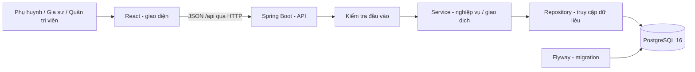
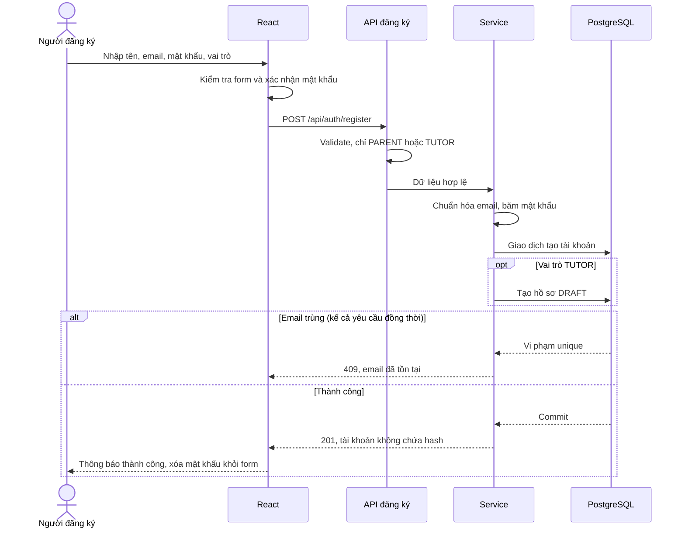
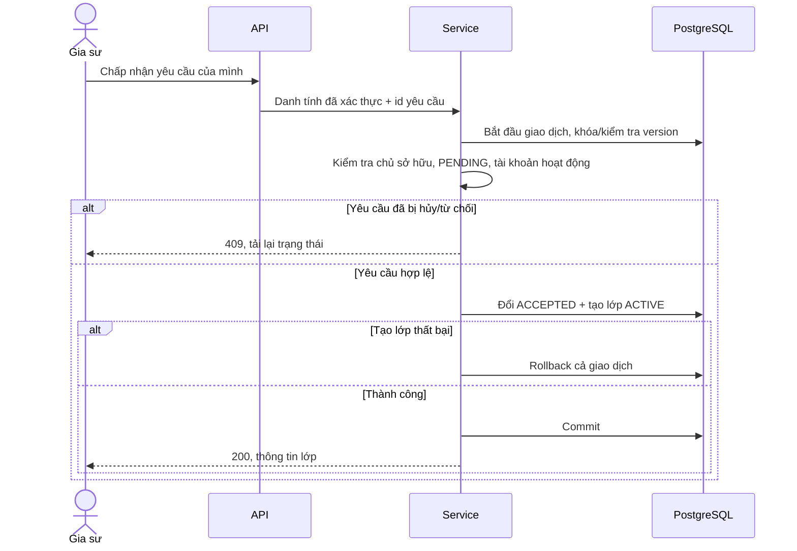

# Kiến trúc hệ thống

## Phạm vi và lựa chọn

Một repository chứa React, Spring Boot, migration PostgreSQL, kiểm thử và tài liệu. Backend là một ứng dụng theo mô-đun nghiệp vụ, phù hợp một người làm trong khoảng 5 tuần. Không tách microservice và không cần message broker ở phiên bản đầu.

Trên máy phát triển, Vite ở cổng 5173 chuyển tiếp `/api` tới Spring Boot ở cổng 8080. Khi triển khai thật, reverse proxy sẽ phục vụ frontend và chuyển `/api` về backend cùng origin; không đưa database trực tiếp ra Internet.

## Cấu trúc mã nguồn

Backend nhóm theo nghiệp vụ: `system` cho trạng thái, `auth` cho tài khoản; sau đó thêm hồ sơ gia sư, yêu cầu học, lớp và đánh giá khi đến lượt. Mỗi mô-đun có controller → service → repository và DTO. Không trả mật khẩu băm hoặc entity nội bộ ra API.

Frontend tách điểm khởi động, lời gọi API, trang và các thành phần được dùng thật. Thư mục nghiệp vụ/lịch học được tạo khi có code tương ứng, tránh nhiều thư mục trống gây hiểu nhầm đã triển khai.

## Hai chế độ chạy

| Profile | Dữ liệu | Mục đích |
|---|---|---|
| demo | Không có database | Kiểm tra frontend/API khởi động, không giả lưu tài khoản |
| postgres | PostgreSQL qua DB_URL/DB_USERNAME/DB_PASSWORD | Chạy migration và đăng ký thật |

API trạng thái chỉ cho biết ứng dụng phản hồi, không bảo đảm toàn bộ database đang khỏe. Profile tích hợp kiểm thử sử dụng schema riêng ngẫu nhiên trên PostgreSQL thật, không dùng H2 thay cho PostgreSQL.

## Luồng UC-02 — Đăng ký

Không đăng nhập tự động sau đăng ký. Đăng nhập, phiên đăng nhập, quên mật khẩu và xác minh email là phần tiếp theo, chưa được suy ra là đã hoàn thành từ UC-02.

## Luồng UC-10 — Chấp nhận yêu cầu (thiết kế, chưa triển khai)

## Bảo mật và vận hành

UC-02 công khai chỉ cho đăng ký hai vai trò. Khóa duy nhất database xử lý cạnh tranh, không chỉ kiểm tra `exists` ở Java. Lỗi trả cho người dùng không chứa SQL, stack trace hoặc mật khẩu. Không lưu mật khẩu ở localStorage, log hoặc repository.

Khi làm UC-03 sẽ triển khai Spring Security và kiểm tra quyền sở hữu ở backend cho từng API; lựa chọn session cookie/CSRF được chốt trước bước đó. Bảo vệ brute-force và giới hạn tốc độ phải được hoàn thiện trước khi đưa đăng ký công khai lên Internet. Hiện mục tiêu chạy cục bộ cho đồ án, không tuyên bố sẵn sàng vận hành công cộng.
