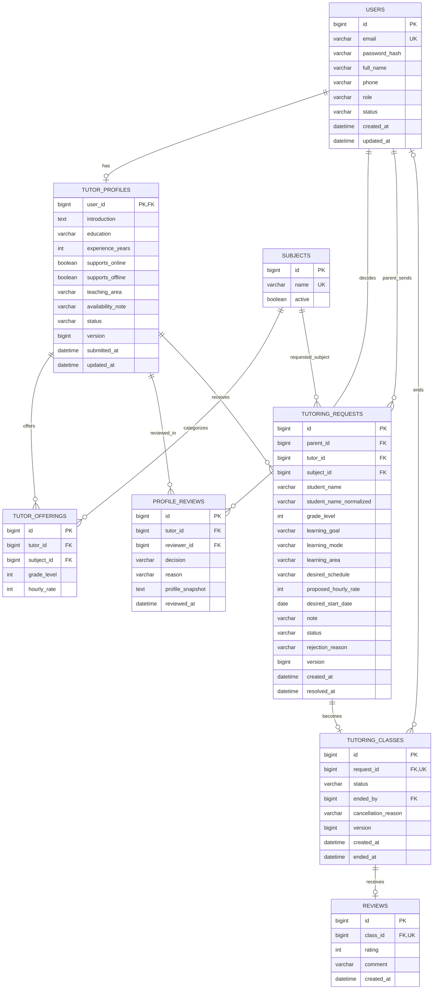

# Thiết kế dữ liệu — ERD bản 0.1

Thiết kế logic cho luồng chính, chưa phải SQL migration hoặc database đã triển khai. PK: khóa chính; FK: khóa ngoại; UK: duy nhất. Mọi ID dùng BIGINT; tiền đồng dùng số nguyên, không dùng float. Mỗi tài khoản có một vai trò PARENT, TUTOR hoặc ADMIN trong phiên bản đầu.

## Sơ đồ ERD

## 1. Giải thích tám bảng

| Bảng | Mục đích | Ví dụ |
|---|---|---|
| users | Tài khoản và vai trò | Một tài khoản phụ huynh |
| tutor_profiles | Hồ sơ riêng của gia sư | Giới thiệu, học vấn, trạng thái duyệt |
| subjects | Danh mục môn | Toán, Tiếng Anh, Vật lý |
| tutor_offerings | Tổ hợp môn và khối lớp mà gia sư dạy | Gia sư A — Toán — lớp 9 — 150.000 đ/giờ |
| profile_reviews | Lịch sử quyết định duyệt | Quản trị viên B duyệt hồ sơ A |
| tutoring_requests | Nội dung đề nghị học | Phụ huynh đề nghị học Toán lớp 9 |
| tutoring_classes | Quan hệ học tập sau chấp nhận | Lớp đang học phát sinh từ yêu cầu |
| reviews | Đánh giá lớp đã hoàn thành | 5 sao và nhận xét |

## 2. Giải thích quan hệ

- Một user có 0 hoặc 1 tutor_profile. Profile dùng user_id làm cả PK và FK; chỉ tài khoản TUTOR được tạo profile, kiểm tra ở backend.
- Một gia sư có nhiều tutor_offerings. Một offering thuộc một môn và một khối lớp. Dùng UNIQUE(tutor_id, subject_id, grade_level). Cách này không tạo nhầm tổ hợp: dạy Toán lớp 9 và Lý lớp 12 không có nghĩa dạy cả Toán lớp 12.
- Một gia sư có thể được xét duyệt nhiều lần. reviewer_id phải là tài khoản ADMIN tại lúc thao tác; lưu snapshot cả nội dung hồ sơ và các offering để biết chính xác nội dung đã duyệt.
- Một phụ huynh và một gia sư đều có thể liên quan nhiều yêu cầu; mỗi yêu cầu chỉ có một phụ huynh và một gia sư.
- Một yêu cầu có 0 hoặc 1 lớp. UNIQUE(request_id) bảo đảm không tạo hai lớp từ một yêu cầu.
- Một lớp có 0 hoặc 1 đánh giá. UNIQUE(class_id) chống đánh giá lặp.
- ended_by của lớp được phép NULL khi đang ACTIVE; sau khi kết thúc phải là phụ huynh hoặc gia sư liên quan, với quyền cụ thể theo hành động.

## 3. Lưu nội dung thỏa thuận ở đâu?

Yêu cầu lưu bản chụp tên gọi học sinh, môn, khối lớp, mục tiêu, hình thức, lịch, mức phí và ngày dự kiến bắt đầu. Các trường nội dung này bất biến sau khi gửi; chỉ trạng thái và thông tin xử lý được cập nhật.

Lớp tham chiếu request_id để đọc nội dung đã thống nhất. Không sao chép thêm parent_id, tutor_id hay mức phí vào lớp ở phiên bản đầu nhằm tránh hai nguồn dữ liệu mâu thuẫn. Giá hiển thị cho lớp lấy từ proposed_hourly_rate của yêu cầu đã được chấp nhận, không lấy từ tutor_offerings hiện tại.

Ví dụ: gia sư tăng giá niêm yết từ 150.000 lên 180.000 đ/giờ thì lớp đã thống nhất 150.000 vẫn giữ 150.000. Nếu sau này cho phép thay đổi thỏa thuận, cần bảng lịch sử/thỏa thuận bổ sung, không sửa yêu cầu gốc.

reviews không lưu thêm parent_id/tutor_id: hai thông tin này lấy qua lớp và yêu cầu. Backend xác định người đánh giá từ phiên đăng nhập, không nhận tùy ý tác giả từ client.

## 4. Trạng thái

| Đối tượng | Giá trị lưu |
|---|---|
| Tài khoản | ACTIVE, LOCKED |
| Hồ sơ | DRAFT, PENDING_REVIEW, APPROVED, NEEDS_CHANGES |
| Quyết định duyệt | APPROVED, NEEDS_CHANGES |
| Yêu cầu | PENDING, ACCEPTED, REJECTED, CANCELLED |
| Lớp | ACTIVE, COMPLETED, CANCELLED |
| Hình thức của yêu cầu | ONLINE, OFFLINE |

Java có thể dùng enum; cơ sở dữ liệu dùng chuỗi với CHECK hoặc ràng buộc tương đương sau khi chốt hệ quản trị. Không lưu chỉ số thứ tự enum vì dễ sai dữ liệu khi đổi thứ tự mã nguồn.

## 5. Ràng buộc dữ liệu

- email: trim, chuẩn hóa chữ thường trước khi lưu và kiểm tra duy nhất; password_hash là mật khẩu đã băm, không lưu mật khẩu gốc.
- profile: kinh nghiệm không âm; ít nhất một hình thức được bật; khi hỗ trợ trực tiếp cần khu vực. Kiểm tra đầy đủ thông tin khi gửi duyệt; bản nháp có thể chưa đủ.
- offering: grade_level từ 1 đến 12; hourly_rate từ 10.000 đến 5.000.000, chia hết cho 1.000. Giá và môn niêm yết phải được kiểm tra ở backend.
- request: các độ dài và giới hạn theo UC-01 ở tài liệu 01; grade_level từ 1 đến 12; ONLINE/OFFLINE phải được gia sư hỗ trợ khi gửi; môn/khối lớp phải tồn tại trong offering; khi OFFLINE cần learning_area.
- Ngày bắt đầu không quá khứ được kiểm tra tại lúc tạo, theo Asia/Ho_Chi_Minh. Không dùng CHECK phụ thuộc ngày hiện tại cho bản ghi cũ.
- request REJECTED cần rejection_reason; request kết thúc cần resolved_at. PENDING không có resolved_at.
- class ACTIVE không có ended_at/ended_by; kết thúc phải có cả hai. CANCELLED cần cancellation_reason. Chỉ tạo lớp từ yêu cầu ACCEPTED trong cùng giao dịch.
- rating nguyên từ 1 đến 5; comment tối đa 1.000 ký tự; lớp phải COMPLETED và người gửi là phụ huynh của lớp.
- Các FK bắt buộc là NOT NULL, ngoại trừ ended_by. Các trường tùy chọn: phone, note, comment, learning_area khi ONLINE, rejection_reason khi không bị từ chối, thông tin xử lý khi chưa xử lý. Trường hồ sơ chưa hoàn thiện có thể NULL ở DRAFT.
- Các mốc thời gian sự kiện lưu UTC, chuyển múi giờ khi hiển thị. desired_start_date là ngày lịch, không phải thời điểm UTC.

## 6. Chống gửi trùng và xử lý đồng thời

Tạm xác định yêu cầu chờ trùng bằng parent_id, tutor_id, student_name_normalized và subject_id. Chuẩn hóa tên bằng trim, gom khoảng trắng, chuyển chữ thường và chuẩn hóa Unicode; giữ nguyên dấu tiếng Việt. Hai học sinh cùng tên vẫn có thể bị nhận nhầm, đây là giới hạn MVP cần khắc phục bằng hồ sơ học sinh riêng.

Vì chưa chốt hệ quản trị, chưa dùng một cú pháp unique index có điều kiện cụ thể. Phương án MVP có thể dùng giao dịch khóa hàng phụ huynh trước khi tìm yêu cầu PENDING trùng và tạo mới; mọi đường tạo yêu cầu phải tuân thủ cùng quy tắc. Khi chọn database sẽ quyết định thêm index hoặc ràng buộc phù hợp. Kiểm tra trùng ở Java mà không có cơ chế đồng thời là chưa đủ.

Chấp nhận/từ chối/hủy yêu cầu dùng kiểm tra version hoặc khóa hàng. Chấp nhận và tạo lớp nằm trong cùng giao dịch. Hoàn thành/hủy lớp cũng dùng kiểm tra trạng thái và version. Khi xung đột trả lỗi nghiệp vụ dễ hiểu, không âm thầm ghi đè.

## 7. Chỉ mục và bảo toàn lịch sử

- UNIQUE: users(email), subjects(name), tutor_offerings(tutor_id, subject_id, grade_level), tutoring_classes(request_id), reviews(class_id).
- Chỉ mục đề xuất: tutor_profiles(status); tutor_offerings(subject_id, grade_level, hourly_rate); tutoring_requests(parent_id, status, created_at); tutoring_requests(tutor_id, status, created_at); profile_reviews(tutor_id, reviewed_at).
- Đánh giá hiệu quả chỉ mục bằng truy vấn thực tế khi triển khai, chưa coi danh sách trên là tối ưu cuối cùng.
- Không xóa dây chuyền tài khoản, yêu cầu, lớp hay đánh giá. Khóa tài khoản thay vì xóa khi đã có lịch sử. Môn đã được dùng được ngừng hoạt động, không xóa; không đổi ý nghĩa môn cũ.
- Sửa offering không làm thay đổi yêu cầu đã gửi. Các ràng buộc yêu cầu chỉ được kiểm tra lại theo chính sách chấp nhận đã ghi trong tài liệu use case.

## 8. Mở rộng sau luồng chính

LessonSession sẽ tham chiếu tutoring_classes và lưu start_at, end_at, trạng thái, ghi chú buổi học. AvailabilitySlot lưu lịch gia sư có thể dạy. Khi đó lịch không chỉ là chuỗi mô tả; việc chống trùng phải so sánh khoảng thời gian và xử lý đồng thời. StudentProfile cung cấp định danh học sinh riêng. Chưa tạo ba bảng mở rộng trong ERD cốt lõi này.

## 9. Cách giải thích khi báo cáo

“Em tách yêu cầu học và lớp học vì yêu cầu có thể bị từ chối hoặc hủy, trong khi lớp chỉ tồn tại sau khi gia sư đồng ý. Em lưu nội dung đề nghị bất biến để việc sửa hồ sơ và học phí niêm yết sau này không làm thay đổi thỏa thuận cũ. Các khóa duy nhất ngăn tạo nhiều lớp cho một yêu cầu và nhiều đánh giá cho một lớp.”

Bước tiếp theo: chốt hệ quản trị cơ sở dữ liệu, chuyển ERD thành migration SQL, thiết kế API theo use case rồi khởi tạo React và Spring Boot. Chưa chọn phiên bản công nghệ trong bản tài liệu này.
